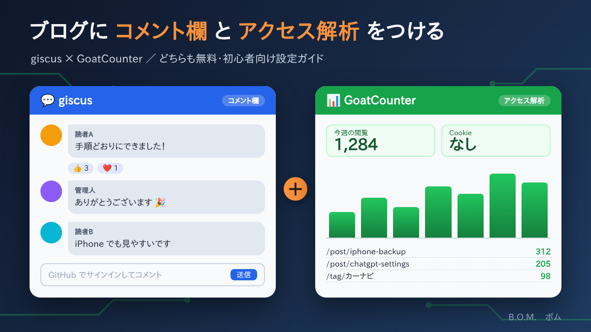

このブログ（GitHub Pages で公開）に、次の2つを追加しました。

- **giscus（ギスカス）**：記事の下につけるコメント欄
- **GoatCounter（ゴートカウンター）**：何人がどのページを見たかが分かるアクセス解析

どちらも**無料**で、**広告なし**です。次に設定するときに迷わないよう、手順をメモしておきます。

---

## 1. giscus（コメント欄）

### giscus とは

GitHub の「**Discussions**（ディスカッション＝掲示板機能）」を、ブログのコメント欄として使えるようにするしくみです。

- 公式サイト：<https://giscus.app/ja>
- 料金：無料（オープンソース）

### 主な特徴

| 特徴 | 内容 |
|---|---|
| 無料・広告なし | 自分でサーバーやデータベースを用意する必要がない |
| コメントは自分のリポジトリに保存 | コメントは GitHub の Discussions に保存されるので、自分で管理できる |
| 記事ごとにスレッド | 記事ごとに自動で別々のスレッドができる |
| リアクション | 👍 ❤️ 🎉 などの絵文字で気軽に反応できる |
| ダークモード対応 | ブログの明るさ（ライト／ダーク）に合わせて色が変わる |

ほかにも、返信（スレッド形式）、Markdown での書式つきコメント、日本語表示などの機能があります。

> ⚠ **注意**：コメントを書くには、読者が **GitHub アカウントでログイン**する必要があります。匿名ではコメントできません。IT に慣れた読者向けのコメント欄です。

### 設定手順

全部で4ステップです。

#### 手順1：Discussions を有効にする

1. GitHub で自分のリポジトリを開く
2. 上のタブの **Settings** → **General**（最初に開く画面）
3. 下にスクロールして **Features** の **Discussions** にチェックを入れる
4. 表示される **Set up discussions** ボタンを押す
5. 歓迎の投稿の画面が開くので、そのまま **Start discussion** を押す

これで、リポジトリの上部に **Discussions** タブが出ます。

#### 手順2：コメント用のカテゴリーを作る

1. **Discussions** タブを開く
2. 左の **Categories** の横にある ✏（鉛筆）を押し、**New category** を押す
   - 次の URL を開けば、作成画面に直接行けます（`ユーザー名/リポジトリ名` は自分のものに置き換え）
     `https://github.com/ユーザー名/リポジトリ名/discussions/categories/new`
3. 次のように入力して **Create** を押す
   - Category name：`Comments`
   - Discussion Format：**Announcement**（新しい話題を立てられるのは管理人と giscus だけになり、読者は返信のみできる形式）

> 💡 **つまずきポイント**：「About pinned discussions」という吹き出しが出て、左側の文字が隠れることがあります。これは「ピン留めの案内」なので、× や Dismiss で閉じて大丈夫です。

#### 手順3：giscus アプリをインストールする

1. <https://github.com/apps/giscus> を開く
2. **Install** を押す
3. **Only select repositories** を選び、ブログのリポジトリだけを選ぶ
4. **Install** を押す

> 💡 **つまずきポイント**：設定画面の一番下に赤い字で **Danger zone** と出ますが、エラーではありません。「アンインストール」などの取り消しにくい操作をまとめた欄なので、**押さずにそのまま**にしておきます。

#### 手順4：設定値を取得して、ブログに貼る

1. <https://giscus.app/ja> を開く
2. 「リポジトリ」欄に `ユーザー名/リポジトリ名` を入力
   → 「成功！このリポジトリはすべての条件を満たしています。」と出れば OK
3. 「Discussion のカテゴリー」で **Comments** を選ぶ
4. 下に表示されるコードの中から、次の4つの値をメモする

```html
data-repo="ユーザー名/リポジトリ名"
data-repo-id="R_xxxxxxxx"
data-category="Comments"
data-category-id="DIC_xxxxxxxx"
```

5. このブログの場合は、`site.config.json` の `comments` に貼り付けて保存する

```json
"comments": {
  "repo": "ユーザー名/リポジトリ名",
  "repoId": "R_xxxxxxxx",
  "category": "Comments",
  "categoryId": "DIC_xxxxxxxx"
}
```

> 💡 一般的なブログでは、giscus.app に表示された `<script …>` のコードを、コメント欄を出したい場所にそのまま貼り付けます。

### 使い方

- **読者**：記事の一番下のコメント欄で「GitHub でサインイン」→ コメントを書いて送信
- **管理人**：コメントは GitHub の **Discussions → Comments** に、記事ごとのスレッドとしてたまっていく
  - 返信は、ブログのコメント欄からでも Discussions からでもできる
  - いたずらや不適切なコメントは、Discussions から**削除・非表示**にできる
  - コメントが付くと、GitHub から通知が届く（GitHub の通知設定による）
- 特定の記事でコメント欄を出したくないときは、記事のフロントマターに `comments: false` を書く

---

## 2. GoatCounter（アクセス解析）

### GoatCounter とは

ブログの**閲覧数**や、**どのページがよく読まれているか**が分かるアクセス解析サービスです。

- 公式サイト：<https://www.goatcounter.com/>
- 料金：個人の非営利サイトは無料（オープンソース）

### 主な特徴

| 特徴 | 内容 |
|---|---|
| Cookie を使わない | Cookie の同意バナー（「Cookie を許可しますか？」）を出さなくてよい |
| 個人情報を集めない | 訪問者個人を特定・追跡しない、プライバシーに配慮した設計 |
| 軽い | 読み込むスクリプトが小さく、ブログの表示が遅くならない |
| 画面がシンプル | 必要な数字だけが1画面にまとまっていて、初心者でも見やすい |

ほかにも、期間を指定した集計、データの書き出し（CSV）、自分のアクセスの除外などの機能があります。

### 設定手順

#### 手順1：登録してサイトコードを決める

1. <https://www.goatcounter.com/signup> を開く
2. 次の項目を入力する
   - **Code**（サイトコード）：好きな名前を半角英小文字・数字・ハイフンで決める（例：`bom-blog`）
     → `https://bom-blog.goatcounter.com` が自分専用の集計ページになる
   - メールアドレス、パスワードなど
3. 登録すると確認メールが届くので、メールのリンクを開く

> 💡 サイトコードを忘れたら：GoatCounter にログインしたときの URL `https://〇〇〇.goatcounter.com/` の **〇〇〇** の部分がサイトコードです。

#### 手順2：ブログに設定する

このブログの場合は、`site.config.json` にサイトコードを書くだけです。

```json
"analytics": { "goatcounter": "bom-blog" }
```

> 💡 一般的なサイトでは、GoatCounter の管理画面に表示される `<script data-goatcounter=…>` のコードを、ページの HTML に貼り付けます。

#### 手順3：計測されているか確認する

1. 設定を公開して1〜2分待ち、ブログの記事をいくつか開く
2. `https://サイトコード.goatcounter.com` にログインする
3. 「TOTAL」などに数字が入っていれば成功

> 💡 数字が増えないとき：広告ブロッカーや Safari のコンテンツブロッカーが計測を止めていることがあります。一時的にオフにして試してください。

### 使い方（集計画面の見方）

| 見られること | 内容 |
|---|---|
| 閲覧数の推移 | 日ごと・週ごとのグラフ |
| ページ別の閲覧数 | `/post/記事名` ごとに、どの記事がよく読まれているか |
| どこから来たか | 検索エンジン、SNS、ほかのサイトのリンクなど |
| 閲覧環境 | ブラウザ（Safari／Edge など）、OS、画面サイズ（スマホ／PC） |

- 数字の単位「**visit**」は、同じ人が同じページを短時間に何度開いても1回として数えたものです。
- 期間は画面上部で切り替えられます。

---

## まとめ

| | giscus | GoatCounter |
|---|---|---|
| 役割 | コメント欄 | アクセス解析 |
| 料金 | 無料 | 個人の非営利サイトは無料 |
| 必要なもの | GitHub アカウント（読者も） | GoatCounter のアカウント（管理人のみ） |
| データの保存先 | 自分の GitHub Discussions | GoatCounter |
| 設定にかかる時間 | 15分くらい | 5分くらい |

どちらも「登録して、値を1か所に貼るだけ」で使えました。コメントや閲覧数が見えると、記事を書く励みになります。
