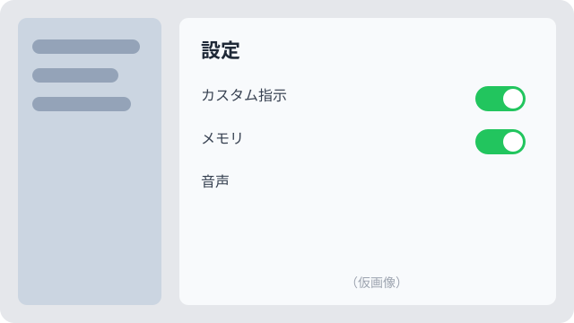

これは **Markdown 形式（`type: md`）** のサンプル記事です。このファイル（`index.md`）をコピーして、新しい記事のひな形にできます。

## やりたいこと

- ChatGPT アプリを入れたときの初期設定を忘れないようにメモする
- 次に機種変更したとき、このページを見れば同じ状態に戻せるようにする

## 手順

1. アプリを開き、左上のメニューから **設定** を開く
2. 「パーソナライズ」→「カスタム指示」をオンにする
3. 下の文章を貼り付ける

```text
回答は日本語で、結論を先に、箇条書きで簡潔にお願いします。
```

> **メモ：** 設定項目の名前はアップデートで変わることがあります。変わっていたら、この記事も直しておくこと。

## 設定値の一覧（表の例）

| 項目 | 設定 | 備考 |
|---|---|---|
| 言語 | 日本語 | 自動でも可 |
| メモリ | オン | 不要なら後で削除できる |
| 音声 | Breeze | 好み |

## 画像の例

記事フォルダの中に画像を置き、相対パスで書きます。



## コマンドの例（コピーボタン付き）

```bash
node scripts/build-index.mjs --include-drafts
```

以上。
