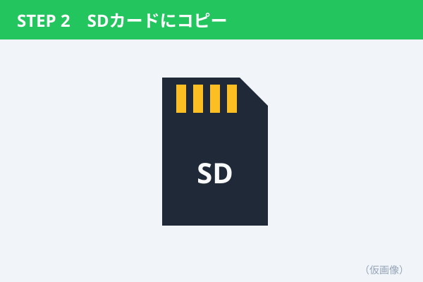

紙芝居形式では、`##` 見出しごとに「画像＋説明」が1セットになります。画像はタップで拡大できます。

## 1. 更新データをパソコンでダウンロード

メーカーのサイトにログインし、**最新の地図データ**をダウンロードします。

- 容量が大きいので Wi-Fi 推奨
- SD カードは 32GB 以上を用意

## 2. SD カードにコピー

ダウンロードしたフォルダを、**フォルダごと** SD カードの一番上にコピーします。

## 3. カーナビに差し込んで更新

エンジンをかけた状態で SD カードを差し込み、画面の案内に従って「更新開始」を押します。

> 更新中はエンジンを切らないこと（約30分）。
