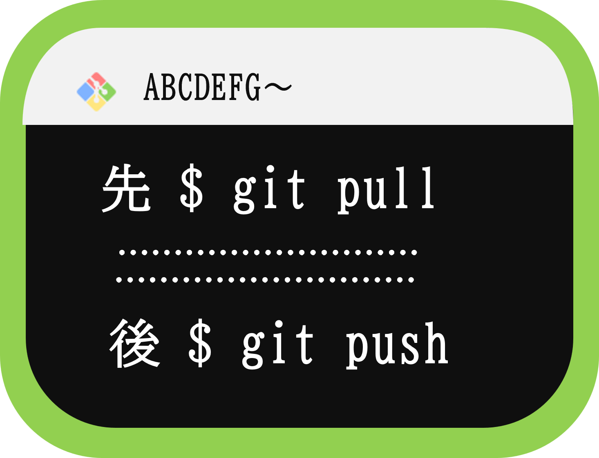
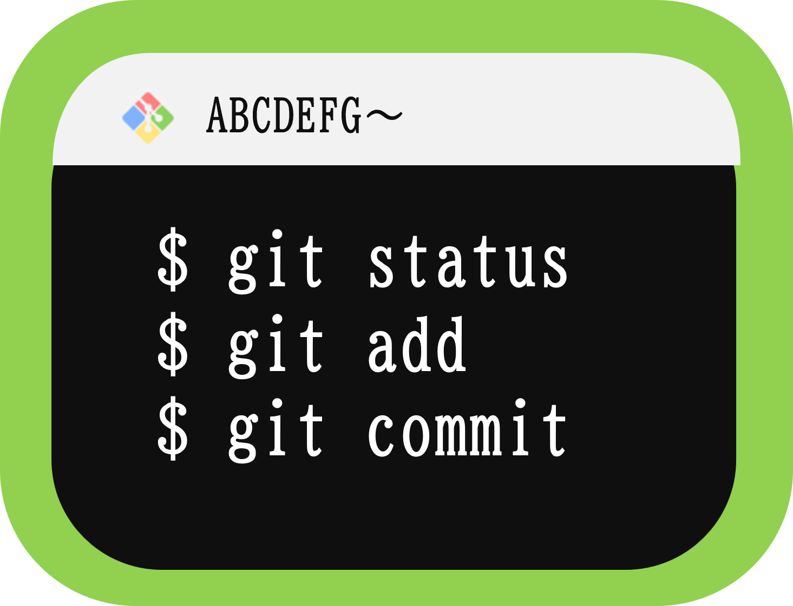

## 1. 「git pull」が、GitHubにファイルを上げるときのファースト・ステップ

変更や追加を、GitHubに上げます。
先にpushしたら、いきなりテキストエディタが出てきて、あせりました。

**絶対にpushより、pullが先！　忘れてはいけません。**

## 2. 先ほどの、pullとpushのあいだに、３行が入ります。

- git status　　　　　　：赤文字のファイルの確認 
- git add ファイル名　　：アドをします
- git commit -m "理由" ：コミットします

あとは、サイトを確認してＯＫです。