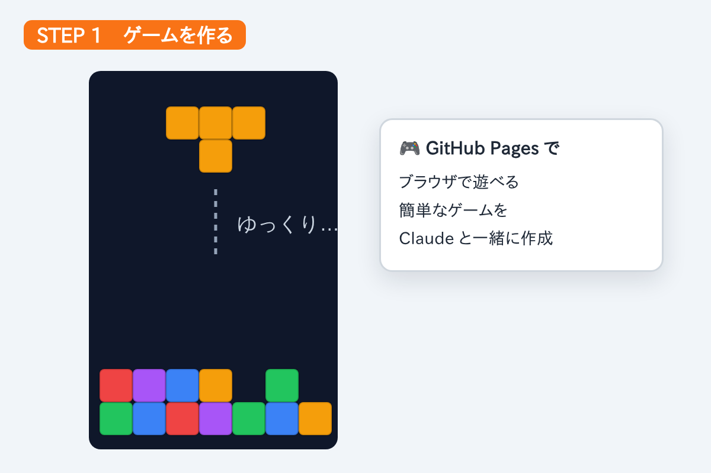
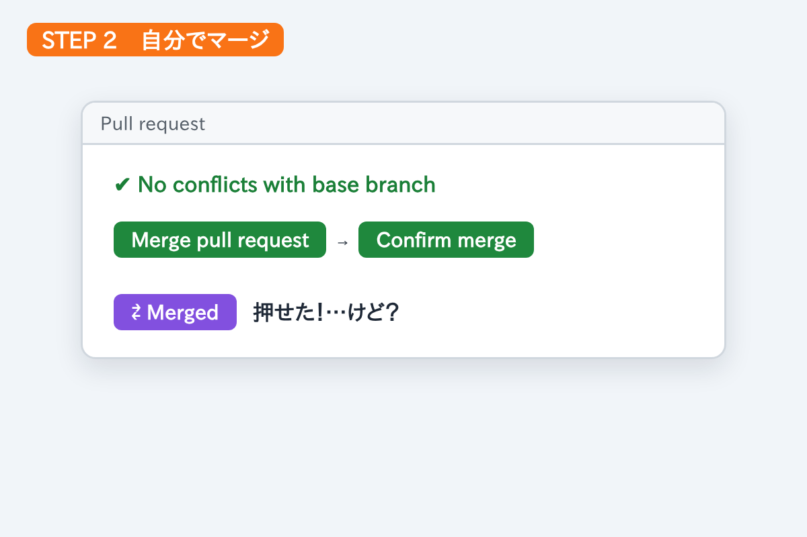
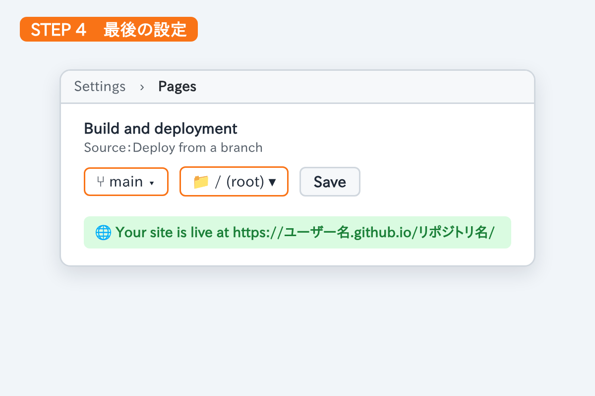

前回の記事「[自分で作って、自分でマージする プルリクエスト入門](#/post/2026-11-02-pull-request-practice)」の実践編です。
練習の題材に、**ブラウザで遊べる簡単なゲーム**を Claude と一緒に作ってみました。

## 1. GitHub Pages で簡単なゲームを作った

新しいリポジトリを作り、Claude にゲームを作ってもらいました。
ブロックが **ゆっくり** 落ちてくる、のんびり遊べるゲームです。

Claude には「**プルリクエストは自分で作るので、ブランチにプッシュするところまで**」とお願いしました。
これで、ゲーム作りとプルリクエストの練習が一度にできます。

## 2. プルリクエストを作って、自分でマージ

前回の記事の手順どおりに進めました。

1. リポジトリのトップの黄色い帯から **Compare & pull request**
2. **Create pull request**
3. **Files changed** で変更内容をひととおり確認
4. **Merge pull request** → **Confirm merge**
5. 紫の **Merged** になったら **Delete branch**

ボタンは全部押せました。…でも、本当にこれで良かったのかな？

## 3. 「うまくいったでしょうか？」と思わず聞いてしまった

マージしたあと、思わず Claude に聞いてしまいました。

> マージしましたが、うまくいったでしょうか？

答えは「マージはできています。**あと1つ設定すると公開されます**」。
自分で作ってマージまでしたのに、最後は確認したくなるものですね。

次からは自分で確かめられるように、チェック方法もメモしておきます。

| 確認する場所 | うまくいったときの表示 |
|---|---|
| プルリクエストの画面 | 紫の **Merged** |
| **Actions** タブ | **pages build and deployment** が ✅（緑） |
| **Settings → Pages** | **Your site is live at …** と公開 URL が表示される |

## 4. 最後の手順：GitHub Pages の設定

**新しく作ったリポジトリでは、最初に1回だけ** GitHub Pages を有効にする設定が必要でした。

1. リポジトリの **Settings** → 左のメニューの **Pages**
2. 「Build and deployment」の **Source** が **Deploy from a branch** になっているか確認
3. **Branch** を **main**、フォルダを **/ (root)** にする
4. **Save** を押す
5. 数分待つと、画面上部に **Your site is live at …** と公開 URL が出る

> 💡 この設定はリポジトリごとに1回だけです。2回目からは、マージするだけで1〜2分後に自動で公開されます。

## 5. できあがり

まだ調整中ですが、ここで遊べます。

**▶ <https://hungrycyano.github.io/slow-tetris/>**

ゲームを作れたこと以上に、**プルリクエストを自分で作ってマージできた**のがうれしい練習になりました。
次は、遊んでみて気になったところを直して、またプルリクエストで反映してみます。
