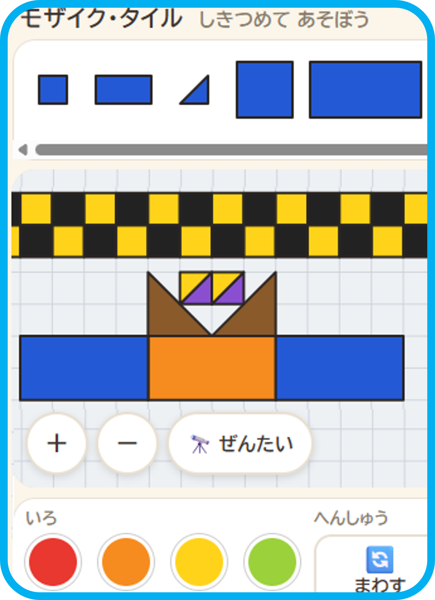

前回に続き、クロードとツールを作りました。作業には慣れましたが、GitBashのタイプミスが直りません。ちょこちょこ、一文字間違えます。
前回は「⁻」がひとつ足りず、今回は「source」が「sour**s**e」でした。笑えます。

## 1. モザイク・タイル　三角や四角をならべ模様を作るツールを作りました

三角や四角で模様作り。地味に楽しいのでツールにしました。
ここで遊べます。主に小学生向きですが、おとなでも楽しめます。ひまつぶしに、どうぞ。

**▶ <hhttps://hungrycyano.github.io/mosaic-tiles/>**

**今回は、プルリクエストを自分で作ってマージ**が、出来るようになりました。

最初はプルリクエストで止まりました。
でも、大丈夫です。チャットに、薄いグレーで「PRを作ってください」と、次の言葉の例が表示される。
次に、クロードが「プルリクエストを作りますか」と聞いてくれます。

そして今日、クロードは何も聞きませんでした。
わたしは、「プルリクエストを作ってマージしました」と送りました。

ちょっと嬉しかったです。