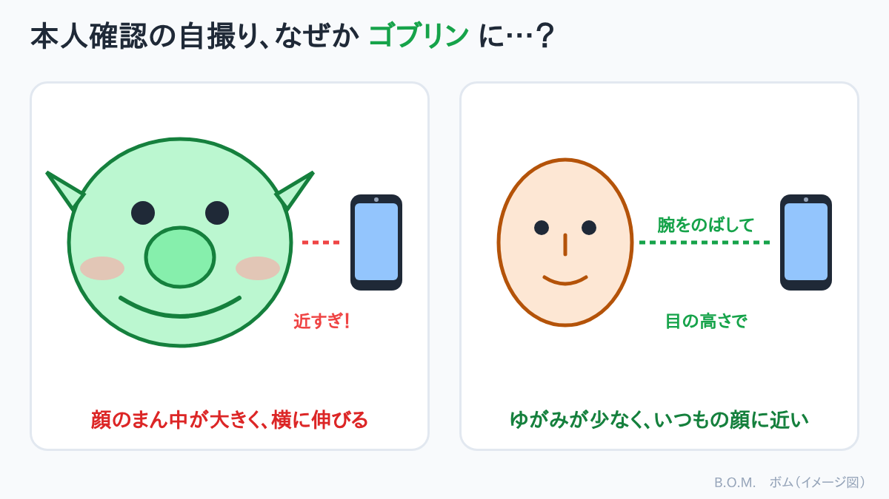

## 急に始まった本人確認

世の中は情報漏洩で騒いでいます。
その結果、ネットの認証が厳しくなるのは当然です。

とあるサイトを使っていたら、急に **本人確認（eKYC）** の画面が出てきました。
身分証と、スマホで撮った自分の顔写真を送るタイプです。

## でもね、写真がデフォルメされている

急いで撮った写真を見てびっくり。顔がデフォルメされているんです。
口の中に角ばったブロックを入れたら、ほっぺたがゴムのように伸びた、みたいな感じ。

何度撮り直しても同じなので、諦めました。
ちょっとゴブリンっぽくて、これはこれで面白いかも。😅

最初は「骨格認証？のせいで、顔を加工されているのかな」と思いました。
でも調べてみると、原因はたぶん別のところにありました。

## 顔がゆがむのは「近すぎ」が原因

スマホの前面（自撮り用）カメラは、広い範囲が写る **広角レンズ** になっていることが多いです。
広角レンズで顔に近づいて撮ると、

- カメラに近い **顔のまん中（鼻や口のまわり）が大きく** 写る
- カメラから遠い **顔の横や耳は小さく**、ほっぺたが **横に伸びた** ように見える

という「ゆがみ」が起きます。本人確認の画面は、顔を枠いっぱいに入れるように言われることが多いので、ついスマホを顔に近づけてしまいがちです。

つまり、ゴブリンの正体は「アプリの加工」ではなく、**レンズと距離のいたずら** だったようです。

## 次に撮るときのコツ

| コツ | 内容 |
|---|---|
| 腕をのばす | スマホを顔から少し離す。それだけでゆがみが減る |
| 目の高さで構える | 下から見上げると、あごや鼻の穴が大きく写る |
| 明るい場所で | 窓のほうを向くなど、顔の正面から光が当たる場所で |
| 枠は「ちょうど」に | 枠に合わせるために近づきすぎない。離れて枠に収まる位置を探す |
| 急がない | 本人確認の画面が出ても、あわてずに場所と姿勢を整えてから撮る |

> ⚠ 本人確認で撮った写真や身分証の画像は、大切な個人情報です。ブログや SNS には載せないようにしましょう（この記事の画像もイメージ図です）。

## これからの証明写真は…

本人確認が通ればそれで良いのですが、ゴブリンの自分が記録に残るのは、ちょっと複雑な気分です。

これからの証明写真は、整った美しさよりも、
**個体を強調した写真** が「いい写真」になるのかもしれません。
