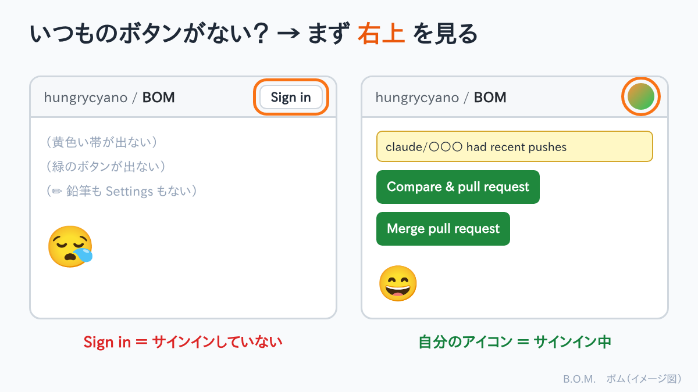

## いつものボタンがない！

朝、[本の記事](#/post/2026-11-06-study-book)を投稿しようとしました。
いつものように GitHub のリポジトリを開いて、プルリクエストを作ろうとしたら……

- いつもの **黄色い帯**（had recent pushes）がない
- 緑の **Compare & pull request** も **Create pull request** もない

「あれ？ ブランチが届いていない？」「何か壊した？」と、しばらく画面の中を探し回りました。

## 原因：サインインしていなかった

答えはとても単純でした。**GitHub にサインインしていなかった** のです。

寝起きのぼけた頭で、ブログの内容のことばかり考えていて、サインインのことはすっかり忘れていました。
しかも、このミスは **一度や二度ではありません**。

## サインインしていないと、何が起きる？

公開リポジトリは、サインインしていなくてもファイルを見られます。
だから一見いつもどおりの画面に見えて、気づきにくいのです。でも、**変更に関わるボタンは全部出てきません**。

| サインインしていないと出ないもの |
|---|
| 黄色い「had recent pushes」の帯と **Compare & pull request** |
| **Create pull request**、**Merge pull request** などの緑のボタン |
| ✏（鉛筆）での編集、**Delete directory** |
| **Settings** タブ |

## 見分け方：まず右上を見る

| 画面の右上 | 状態 |
|---|---|
| **Sign in** と書いてある | サインインしていない → 押してサインインする |
| **自分のアイコン**（丸い画像）がある | サインインしている |

## 次からの、私の確認の順番

「いつものボタンがない！」と思ったら、慌てる前にこの順で確認します。

1. **右上を見る**：Sign in ならサインインする（だいたいこれで解決）
2. **リポジトリが合っているか**：`hungrycyano / BOM` になっているか
3. **黄色い帯がなければ**：帯は push してから1時間くらいで消えるので、**Pull requests** タブ → **New pull request** から作る

## おわりに

ブログの中身を考えるのに夢中で、入口の鍵を開け忘れていた、という話でした。
寝起きの作業は、まずコーヒー。それから右上のアイコン。☕

失敗談のネタは、やっぱり尽きません。😅
