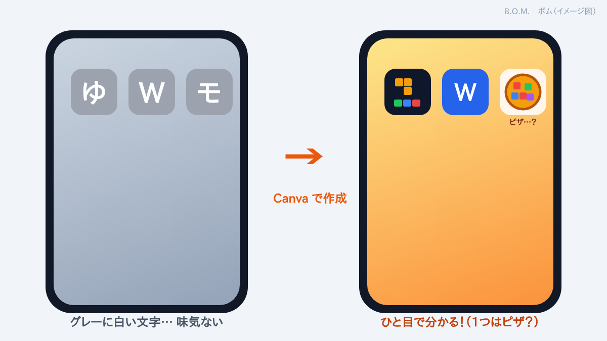

## グレーに白い文字が一文字だけ

自分で作ったウェブアプリやサイトを、iPhone のホーム画面に追加しました。
ところが、アイコンは **ぜーんぶグレーで、白い文字が一文字（「ゆ」「W」など）書いてあるだけ**。
どれがどれだか分かりにくいし、味気ない。

サイトにアイコン画像が設定されていないと、iPhone はこういう仮のアイコンを出すそうです。

## Canva でアイコンを作った

Canva を立ち上げて、**1024×1024 の正方形**で、アイコン画像を PNG で **3つ** 作りました。

作った画像を Claude に送って、それぞれのサイトにアイコンとして設定してもらいました。
（iPhone のホーム画面用のアイコンは `apple-touch-icon` と呼ばれ、180×180 の PNG がよく使われます。大きめに作っておけば、縮めて使えます）

> 💡 **アイコンが変わらないときは**：ホーム画面のアイコンは、追加したときの画像が残ります。サイト側を直したら、ホーム画面のアイコンを一度削除して、Safari の共有ボタン →「ホーム画面に追加」でもう一度追加します。

## 今回は落ち着いてプルリクエスト

今回は **コーヒーを飲んでから** 作業したので、余裕をもってプルリクエストを作れました。☕（[前回の反省](#/post/2026-11-06-forgot-sign-in)）

プルリクエストを作るときに、画面の **クルクル（読み込み中のマーク）** が止まらなくなりましたが、冷静に対応。
今回の Claude のアドバイスはこれでした。

> **GitHub の画面が止まってしまったら、ページを再読み込みしてみてください。**

再読み込みしたら、すぐに直りました。もうクルクルは怖くありません！

## と喜んで git pull したら……

手元のパソコンでも最新にしておこうと、Git Bash で `git pull` を始めたら……

**途中でリポジトリ名を変えたアプリの、手元のフォルダが前の名前のまま！**
しかも中には `README.md` しか入っていません。名前を変えたことを、すっかり忘れていました。

## 手元のフォルダと接続先を、新しい名前に直す手順

手元のリポジトリには、GitHub の **古い URL** が接続先として登録されたままです。
GitHub は古い URL から新しい URL へ自動で案内してくれますが、接続先も新しい名前に直しておくと確実です。

1. **Git Bash とエクスプローラーのウィンドウを閉じる**
   （そのフォルダを開いていると、名前を変えられないことがあるため）
2. **エクスプローラーで、フォルダ名を新しい名前に変える**
3. **Git Bash を開き直して、新しいフォルダに移動する**

   ```bash
   cd ~/新しいフォルダ名
   ```

4. **接続先を新しい URL に直す**（URL の最後は、GitHub の **新しいリポジトリ名**）

   ```bash
   git remote set-url origin https://github.com/ユーザー名/新しいリポジトリ名.git
   ```

5. **接続先が変わったか確かめる**（fetch と push の2行とも、新しい URL になっていれば OK）

   ```bash
   git remote -v
   ```

6. **もう一度 pull する**

   ```bash
   git pull
   ```

これで、手元のフォルダにもアプリのファイルが全部そろいました。

> 💡 手元のフォルダ名と GitHub のリポジトリ名は、違っていても動きます。でも、そろえておくと迷いません。

## おわりに

今回も、新しい知識が増えました。忘れないように書いておきます。

予想外だったのは、もうひとつ。
アイコン画像のひとつを「モザイク」を意識して作ったのに、**座布団か、ピザにしか見えない** ことです。🍕
でも、ちょっとおもしろいので、直さずにこのまま使います。
