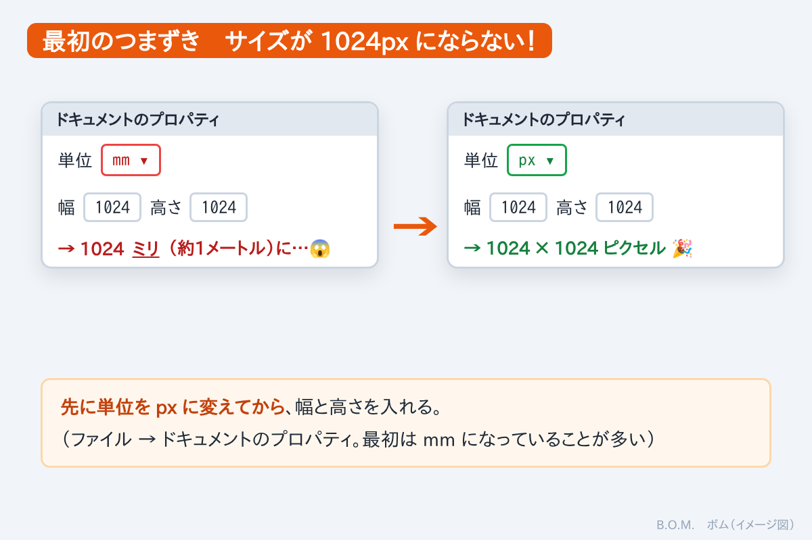
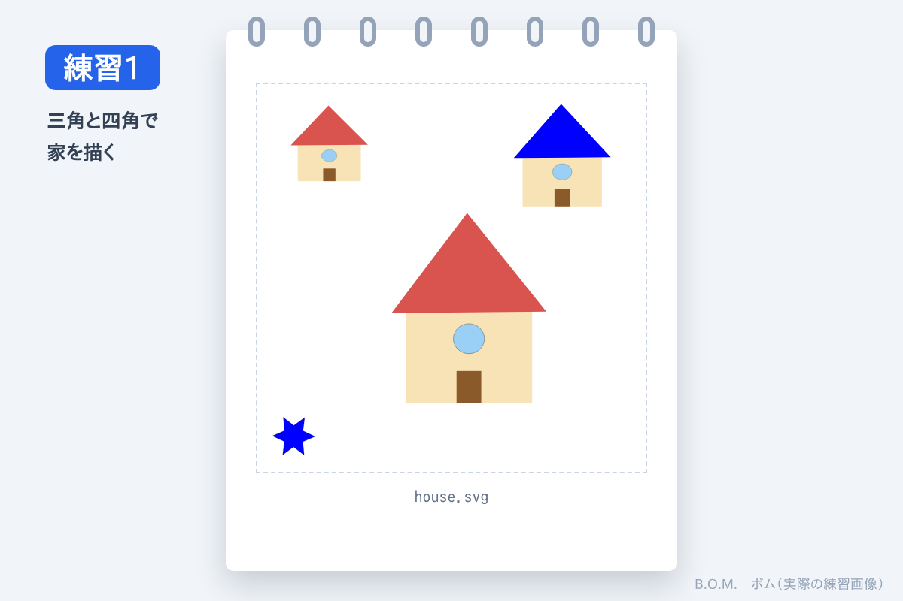
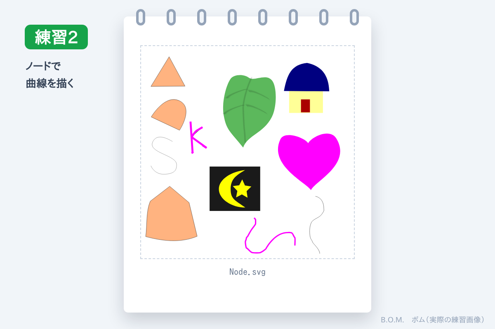
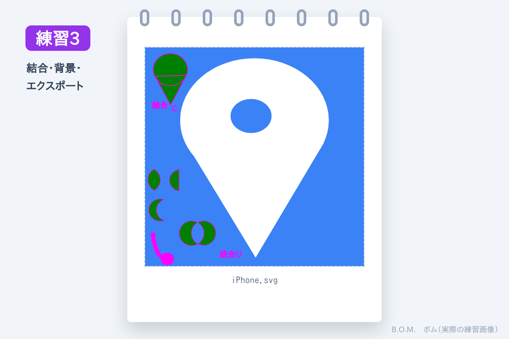

先日、Canva でアイコン画像を作ったら、ひとつが **座布団かピザ** に見えた話を書きました（[iPhone のアイコンの記事](#/post/2026-11-07-iphone-icons)）。
偶然の仕上がりも面白かったけれど、もう少しちゃんと作りたくなって、**Inkscape**（無料のお絵かき・デザインソフト）をインストールしました。

Inkscape は、長年「苦手」と思って手を付けなかったアプリです。
そこで今回は、**Claude に練習用のテキストを作ってもらい**、わからないことはチャットで聞きながら自主練習することにしました。

## 最初のつまずき：サイズが 1024px にならない

まず、最初の画面のサイズ設定でつまずきました。
幅と高さに 1024 と入れたのに、**1024 × 1024 ピクセル** になりません。過去の失敗の記憶がよみがえります。

原因は、**単位がミリメートル（mm）のままで、ピクセル（px）になっていなかった** ことでした。
先に単位を px に変えてから、数字を入れればOKです。

## 練習1：三角と四角で家を描く

最初は、三角や四角を組み合わせて絵を作ります。
最初のつまずきで慎重になっていて、何度もテキストを見直しながら描きました。
**緊張しているのがわかる画面** です。

## 練習2：ノードで曲線を描く

次は **ノード**（線の曲がり角や形を決める点）の練習です。点を動かして、曲線を作る方法を勉強しました。
ハートや葉っぱの形が作れるようになって、少し緊張がとけて落ち着いてきました。

## 練習3：結合・背景・エクスポート

図形を **結合** したり、**背景** を付けたり、消したり。
慣れてきて、最後は PNG 画像への **エクスポート** までできました。

見た目はまだ練習画像ですが、作り方はちゃんと覚えました。

## 数時間で、基礎がわかった

テキストを見ながら自分で手を動かして、わからない所は何回も聞いて……やっと終了。
**数時間で基礎がわかりました。** 自分でも信じられません。

Claude は、私の進み具合や質問に合わせて、テキストに **つまずきポイント** を書き足しながら、その場で直してくれました。
何年か前なら、こんな勉強の仕方は考えられませんでした。

次は、いよいよ本番。座布団ピザに見えないアイコンを作ります。🍕
