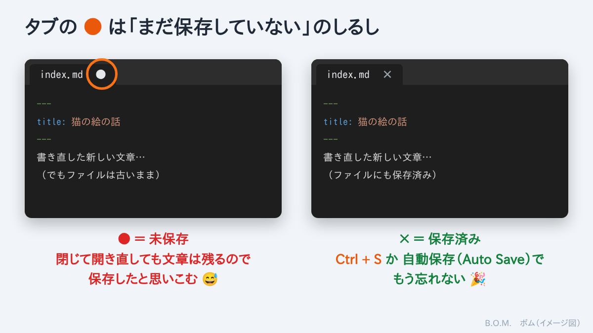

## 送った下書きが、前の記事と同じだった

最近、ブログの文章を **Cursor**（AI 付きのテキストエディタ）で書いています。

[猫の絵の記事](#/post/2026-11-12-inkscape-cat)の下書きを Claude に送ったら、「前回の Inkscape の記事と同じ内容でした」とのこと。

原因はこうでした。

1. 前回の記事の文章を、別の場所にコピー
2. それを Cursor で、猫の話に書き直した
3. **保存しないまま** ファイルを送った

やはり、失敗はありました。笑

## なぜ保存を忘れるのか

Cursor は、**保存しないで閉じても、開き直すと直した文章がちゃんと残っています**。
だから、つい「保存できている」と思いこんでしまうのです。

でも、残っているのは Cursor が覚えているだけで、**ファイルそのものは古いまま**。
保存していないファイルは、タブの名前の横に **●** が付きますが……見落とします。

## 対策：自動保存をオンにする

上のメニューの **File（ファイル）→ Auto Save（自動保存）** を押して、チェックを付けます。
これで、書いた文章が自動で保存されるようになり、● を気にしなくて済みます。

> 💡 すぐに保存したいときは **Ctrl + S**。「送る前に Ctrl + S」と覚えておくと安心です。

## Cursor でブログ記事を書くコツ

### 便利なショートカット

| やりたいこと | 操作 |
|---|---|
| 保存する | **Ctrl + S** |
| 書いた Markdown の見た目を確認する | **Ctrl + Shift + V**（プレビュー） |
| 書きながら横にプレビューを並べる | エディタ右上の、虫めがね付きの四角いボタン（Open Preview to the Side） |
| 長い行を画面の幅で折り返す | **Alt + Z**（日本語の長い文が読みやすくなる） |
| 全部の記事から言葉を探す | **Ctrl + Shift + F** |
| Cursor の中で Git Bash のような画面を開く | **Ctrl + @**（日本語キーボード）。`git pull` もここで打てる |

### ブログ用の書き方の注意

- **フォルダごと開く**：**File → Open Folder** で `BOM` フォルダを開くと、左側に記事の一覧が出て、迷子になりません
- **新しい記事は、フォルダごとコピー**：左の一覧で前の記事のフォルダをコピーして名前を変え、その中の `index.md` を書き直します。別の場所にコピーすると、どれが本物か分からなくなります（今回の失敗のもと）
- **フロントマター（先頭の `---` で囲んだ部分）は半角で**：`title:` や `date:` のあとは半角スペース。全角スペースが入ると読み込まれないことがあります
- **summary は1行で**：途中で改行すると、2行目以降が消えてしまいます
- **送る前に、タブの ● を確認**：● が付いていたら Ctrl + S

> 💡 Cursor には AI のチャットも付いています。「この文章を読みやすくして」「誤字を探して」と頼むと、下書きの手直しにも使えます。

## おわりに

「大きな失敗なし！」と書いた猫の記事の裏で、ちゃんと小さな失敗をしていました。
失敗談のネタは、やっぱり尽きません。😅
