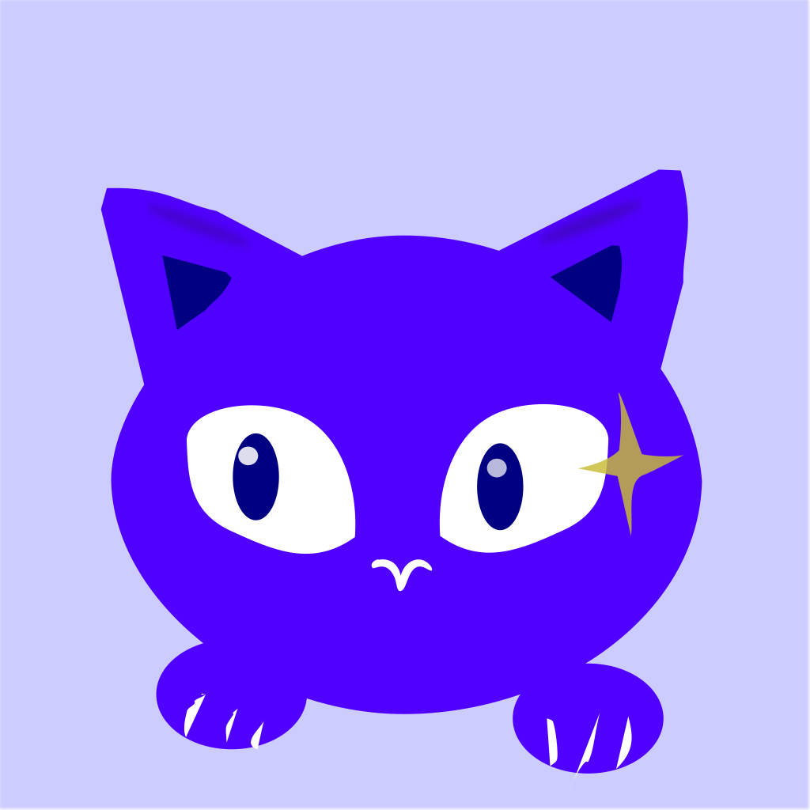

[Inkscape の練習](#/post/2026-11-09-inkscape-practice)の成果を試しに、アイコン用の **猫** を描きました。

お手本は **Lumo（Proton の AI）の猫** です。少しアレンジして、iPhone のホーム画面のショートカットアイコンに使っています。

## 練習で覚えたことを、全部使ってみた

- **ノード**：耳、丸い顔、目、前足の形を、点を動かして曲線で作りました
- **重ねる**：白目の上に黒目、さらに小さな光を重ねて、目をキラッと
- **ぼかし**：耳のふちに、うっすら影
- **エクスポート**：1024 × 1024 ピクセルの PNG で書き出し

最初に単位を **px** にするのも、もう忘れません。

## めずらしく、大きな失敗なし

いつもなら何かしら事件が起きるのですが、今回は **大きな失敗なし**。
失敗談のネタがないのは、ちょっとさみしいくらいです。

## ノード曲線が楽しい

数日前までは「苦手なアプリ」だった Inkscape。
今は、ノードを少しずつ動かして、思った形の曲線になっていくのが楽しいです。

座布団ピザのリベンジ、ひとまず達成。🐈
