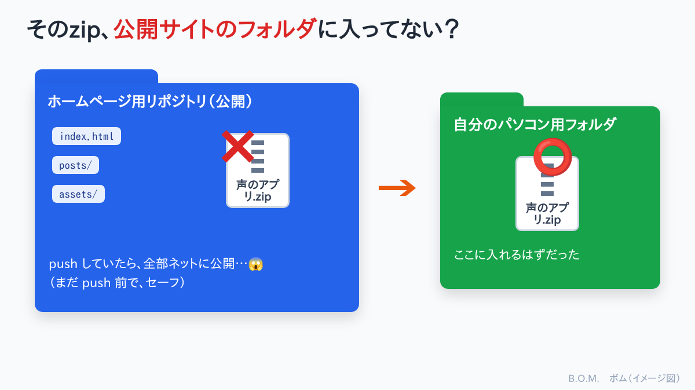

## とんでもないビッグチャンス

世の中が、急激に AI の普及に向けて進んでいます。
そんななか、AI 初心者の私にも、とんでもないビッグチャンスが訪れました。

なんと、最新の **Fable**（Claude の最新モデル）が、期間限定で使えるのです。

何年かして初心者を卒業したら、いつか使ってみたい。そう思っていた遠い夢が、すぐ近くにある。
もうこれは、つかむしかない。
思い切って、**声のアプリ**（文章を読み上げる TTS アプリ）を作ることにしました。心臓がドキドキです。

## アプリはできた。でも失敗もたくさん

結論から言うと、アプリはちゃんとできました。
ただ、そこにたどり着くまでに、たくさん失敗しました。
多すぎて全部は思い出せないので、いちばんの失敗を書いておきます。

## パソコン用のアプリを、公開リポジトリに入れてしまった

Fable が「ダウンロードして、パソコンに保存してください」と渡してくれた **zip のアプリ**。
これを何を勘違いしたのか、**ホームページ用のローカルリポジトリの中** に入れてしまいました。

パソコンの中だけで使うはずのアプリを、**ネットに公開しているサイトの中に入れる** って、どういうこと！
自分では、ちゃんと別の場所に保存したつもりでした。たくさんのウィンドウを開いて、作業や確認を同時にしていたので、間違えたようです。

幸いなことに、**まだ push はしていませんでした**。

## Fable に相談して、やり直し

しかたがないので、Fable に相談しました。
ちょうど何度かアプリを直してもらっていたので、答えは
「**新しい zip ファイルを別のフォルダに入れて、最初のフォルダは削除して大丈夫です**」とのこと。

めっちゃ賢いし、クールだし、優しかった。

## 次に備えて、私がやること

今回は、はっきりした「解決法」というより、push 前に気づけたことに助けられました。
次からは、これだけは気をつけようと思います。

- **保存するときは、保存先のフォルダ名を見る**：リポジトリのフォルダ（ブログやホームページ）ではないか
- **パソコン用のアプリは、専用のフォルダにまとめる**：リポジトリとは別の場所に、置き場所を決めておく
- **push の前に `git status`**：見覚えのないフォルダやファイルが出てきたら、立ち止まる

## 夢のような数日間

夢のような数日間でした。
期間が終わって、気落ちして2日くらいぼーっと過ごしましたが、今はまた、いつものペースで自分なりに AI を使いながら暮らしています。

**今回の教訓**：ビッグチャンスでも焦らず、落ち着いて行動しよう（……無理かも）。
